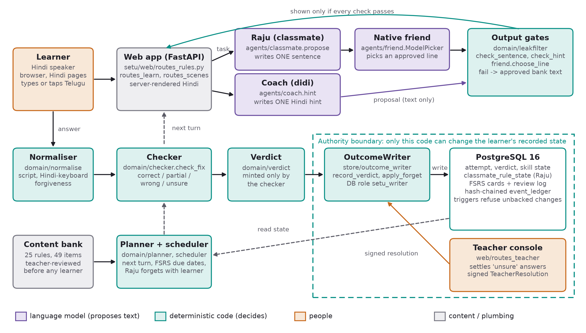

# SETU: a Hindi-first Telugu tutor with a rule-governed AI classmate

SETU helps a Hindi speaker learn Telugu. The learner climbs a ladder (letters → syllables → words → phrases →
sentence rules → short conversations). At the sentence stage the learner corrects **Raju** (राजू), an AI classmate who
makes the mistakes a Hindi speaker makes in Telugu. Raju's knowledge is stored in the database and kept one step
behind the learner's.

The design rule is **models write, rules decide**. A language model may write Raju's sentence, the coach's hint, or
pick a line for the Telugu friend. Ordinary code checks all of it before the learner sees it, and ordinary code
alone marks answers and changes the learner's record.

Course project, Language Models and Agents, IIIT Hyderabad, Monsoon 2026 (team Token Guessers).

> **Read this first.** No learner has used SETU. Every learner outcome in this repository comes from a software
> simulation. The Telugu content is a team-written draft that has had one review by a bilingual team member and no
> independent native review. Known weak results are listed under [Known limitations](#known-limitations).

## What is in the repository

| Path | What |
|---|---|
| `setu/domain/` | Deterministic core: normaliser, checker, leak filter, planner, exchange steps, scheduler (FSRS + mastery) |
| `setu/store/` | Database models, the `OutcomeWriter` (the only code that writes learning state), teacher review |
| `setu/agents/` | Model client and the three model roles (Raju, coach, friend), tool envelope, retrieval |
| `setu/web/` | FastAPI app, server-rendered Hindi pages, teacher console |
| `setu/research/` | Evaluation scripts and both simulators |
| `content/` | The rule and content bank (YAML): 25 rules, 49 items, 48 letters, 489 aksharas, 28 words, 32 chunks, 4 scene scripts |
| `tests/` | 1,300 tests; `tests/eval_sets/` and `tests/stage_a/` hold the frozen evaluation cases |
| `reports/` | Every measured result, as JSON plus a generated Markdown table |
| `docs/submission/` | Paper, poster, figures, audit and walkthrough |
| `legacy/` | The earlier Streamlit prototype, kept runnable |

How the pieces fit, with one learner episode traced through the code:
[docs/submission/final_audit/02_system_walkthrough.md](docs/submission/final_audit/02_system_walkthrough.md).

## Stack

Python 3.11, FastAPI, Jinja2 server-rendered pages, SQLAlchemy 2 + Alembic, PostgreSQL 16, `fsrs==6.3.2`,
pytest, ruff. No front-end build step. Any OpenAI-compatible chat endpoint can serve as the model; none is needed.

## Install

    python3.11 -m venv .venv
    .venv/bin/pip install -e ".[dev]"

PostgreSQL 16 runs in Docker (port 5433, so it does not clash with a local Postgres):

    docker compose up -d db

## Run the demo

    scripts/run_demo.sh            # http://127.0.0.1:8000

The script starts Postgres, builds a separate demo database (`setu_demo`: migrations, content import, approval by two
accounts named `demo-reviewer-*`), prints a learner and a teacher login, and starts the app. Each run rebuilds
`setu_demo` and prints new logins; use `SKIP_SEED=1 scripts/run_demo.sh` to keep the existing one.

- The demo passphrase is printed by the script. These are throwaway accounts in a throwaway database.
- Every page shows a banner saying the content was approved by demo reviewers, not native speakers.
- The 25 real rules still have open validation issues and cannot be activated, so the demo teaches Raju with three
  labelled demo rules (`HI-TE-901` to `903`, titles start with "डेमो").
- Raju normally appears after three ready rules; the demo lowers this to one
  (`SETU_CLASSMATE_START_MIN_RULES=1`).

Useful pages: `/` home, `/learn/letters`, `/learn/rules` (Raju), `/learn/match`, `/learn/scenes`, `/ladder`,
`/review`, `/teacher`, `/teacher/queue`, `/healthz`.

Without Docker: `.venv/bin/uvicorn setu.web.app:app --reload` starts the app, but pages that need the database
will fail.

### Database, migrations, seed data

- Migrations: `migrations/versions/0001` to `0015` (Alembic). Tests and the demo seed apply them with
  `setu.store.migrate.upgrade(url)`.
- Content: `python -m setu.content validate` checks the YAML tree and `python -m setu.content import` loads it as
  drafts (the demo seed does both). Nothing reaches a learner until it is approved in the teacher console.
- Roles: the schema creates restricted database roles, including `setu_app` for the web app and `setu_writer` for
  learning state. The OutcomeWriter switches to `setu_writer` per transaction, so one connection URL is enough for
  development.

### Environment variables

| Variable | Purpose | Default |
|---|---|---|
| `SETU_APP_DATABASE_URL` | App database | set by `run_demo.sh` |
| `SETU_WRITER_DATABASE_URL` | Separate credentials for the OutcomeWriter | app engine |
| `SETU_RESOLUTION_KEY` | Key that signs teacher decisions | demo value from `run_demo.sh` |
| `SETU_DEMO` | Show the demo banner | off |
| `SETU_CLASSMATE_START_MIN_RULES` | Ready rules before Raju appears | 3 |
| `SETU_LLM_URL`, `SETU_LLM_MODEL` | OpenAI-compatible endpoint and model name | unset: no model |
| `SETU_LLM_API_KEY` | Key for a hosted endpoint | unset |
| `SETU_LLM_ALLOW_HOSTED` | `1` to allow a non-local endpoint | local endpoints only |
| `SETU_LLM_REASONING`, `SETU_LLM_TIMEOUT`, `SETU_LLM_RETRIES` | Model call settings | none / 20 s / 1 |
| `SETU_EVAL_INTERVAL`, `SETU_MAX_CALLS` | Evaluation pacing and a hard cap on calls | 6 s / no cap |
| `SETU_SPEECH_INPUT`, `SETU_TTS_SYNTHETIC` | Browser speech features | off |
| `SETU_ENGLISH_GLOSS` | English word under the Telugu word on some cards | on |

Research scripts read a local `.env` (gitignored) through `setu/research/envfile.py`; the app reads the shell
environment only. Never commit keys.

### Model configuration

| Mode | How | What it gives |
|---|---|---|
| No model (default, CI) | leave `SETU_LLM_URL` unset | Everything works; Raju, hints and friend lines come from the approved bank |
| Local model | `SETU_LLM_URL=http://localhost:1234/v1 SETU_LLM_MODEL=<name>` (LM Studio, Ollama, vLLM) | Model proposals, still filtered |
| Hosted model | add `SETU_LLM_API_KEY` and `SETU_LLM_ALLOW_HOSTED=1` | Same; used for the reported runs with `gemini-3.5-flash`, `SETU_LLM_REASONING=none` |

The app sends rule titles, Hindi meanings and bank sentences to the model. It does not send learner identity.
Tests use `MockProvider`, a scripted stand-in that is not a model; no reported number comes from it.

## Tests

    .venv/bin/ruff check .
    .venv/bin/python -m scripts.lint_hindi          # no English letters in learner-facing text
    .venv/bin/pytest -q                             # needs Postgres on 5433; about 6 minutes
    SETU_SKIP_DB_TESTS=1 .venv/bin/pytest tests/unit -q   # no database; about 30 seconds

Each test session creates and drops its own database. Tests never call a model.

## Reproducing the results

Everything below writes to `reports/`. Commands marked *model* need a configured endpoint and spend calls; all can
resume, and a call that fails is recorded as an error, never as a result.

| Result | Command | Needs | Output |
|---|---|---|---|
| Checker and filters on 185 held-out cases | `python -m setu.research.scorecard --split heldout` | nothing | `scorecard-2026-10-31-heldout.{json,md}` |
| Raju generation baselines (task 6) | `python -m setu.research.generation_baselines` | model | `generation_baselines.json` |
| Tool calling, attacks (task 14) | `python -m setu.research.tool_eval` | model (harness replay runs without) | `tool_eval.json` |
| **Generation ablation: memory, model choice, exemplar** | `python -m setu.research.generation_ablation` | model, about 1,000 calls | `generation_ablation.{json,md}`, `generation_ablation_rows.jsonl` |
| Stepwise reasoning (task 15) | `python -m setu.research.reasoning_eval` | model | `reasoning_eval.json` |
| Checker and LLM judge vs native labels (task 13) | `python -m setu.research.judge_eval` | model for the judge | `judge_eval.json`, `agreement_batch_a.json` |
| Coach retrieval and hints (tasks 9, 16) | `python -m setu.research.rag_eval` (`--retrieval-only` needs nothing) | model | `rag_eval.{json,md}` |
| Fine-tuning data and go/no-go (task 10) | `python -m setu.research.ft_data`, `ft_split`, `ft_eval` | model for generation; torch for Gemma | `ft_*.json` |
| Role separation vs single agent (task 18) | `python -m setu.research.agentic_eval` | model | `agentic_eval.json` |
| Simulator v0.1, v0.2 | `python -m setu.research.simulator`, `python -m setu.research.simulator_v2` | nothing | `simulation/`, `simulation_v2/` |
| **Simulator sensitivity map** | `python -m setu.research.sim_sensitivity` | nothing, 10 s | `simulation_sensitivity.json` |
| Result tables | `python -m setu.research.results_tables` | nothing | `results_tables.md` |
| Figures | `pip install -e ".[figures]" && python -m scripts.make_figures` | matplotlib | `docs/submission/figures/` |

Frozen evaluation data (do not edit): `tests/eval_sets/manifest.json` (29 planting cases, held-out split),
`tests/eval_sets/attacks.jsonl` (28 attacks), `tests/stage_a/cases.jsonl` (663 cases), and the label sheets in
`research/labels/`.

## What the results say

Full tables: `reports/results_tables.md`, `reports/rag_eval.md`, `reports/ft_eval.md`,
`reports/generation_ablation.md`. Paper: `docs/submission/report/`. All model runs use `gemini-3.5-flash`.

- **Control holds on our cases.** 17 of 17 replayed tool attacks refused, 0 of 11 injected messages led to an unsafe
  tool attempt, and no model text reached a learner without passing a filter.
- **The checker is safe but coarse.** On 185 held-out cases it caught every wrong answer and rejected no correct
  one, but said `unsure` 18.2% of the time (target under 15%). Against one native speaker's labels on 50 answers it
  agrees poorly (κ = 0.15 [−0.03, 0.31]); a prompt-only LLM judge does better (κ = 0.46 [0.29, 0.64]).
- **Model capabilities mostly did not beat their baselines** on 29 to 58 frozen cases: stepwise reasoning, retrieval
  for hints and role separation showed no accuracy gain; fine-tuning stopped at a data go/no-go (23 usable pairs of
  200 needed). Model-chosen tool calls gave more valid Raju sentences than prompting alone; see
  `reports/generation_ablation.md` for how much of that is tool choice and how much is simply letting the model see
  its own rejected draft.
- **"Valid" generation is a narrow measure.** The filter accepts only the bank's wrong sentence for 43 of 49 items,
  and that sentence is in the prompt, so a valid generation mostly means the model copied it.
- **Simulated learners do not support reverse learning.** The first simulator has correcting Raju ahead of the
  same content without him; the second, which uses the app's FSRS memory model, has it last, and it stays last across
  28 changed-assumption runs. Neither is evidence about people.

## Known limitations

- No human learner data. A pilot needs reviewed content, consent and institutional clearance first.
- Telugu content: one non-independent review; 9 of 15 Hindi→Telugu rule explanations are unreviewed drafts; only
  the Hindi→Telugu direction is built into the app.
- Native labels come from one labeller (a team member), so there is no human–human agreement ceiling.
- Evaluation sets are small (29, 58, 50 cases) and team-written; most model results are single runs.
- The app's Raju loop uses harness feedback (`method="tool"`); model-chosen tool calls and retrieval-based hints
  exist only in the research scripts.
- Speech features are off; browser speech recognition would send audio to a third party.
- The interface additions (path map, word pictures, match game) were built but not evaluated.

## Legacy app

    cd legacy
    python3.11 -m venv .venv && .venv/bin/pip install -r requirements.txt
    .venv/bin/python -m pytest -q
    .venv/bin/streamlit run app.py
