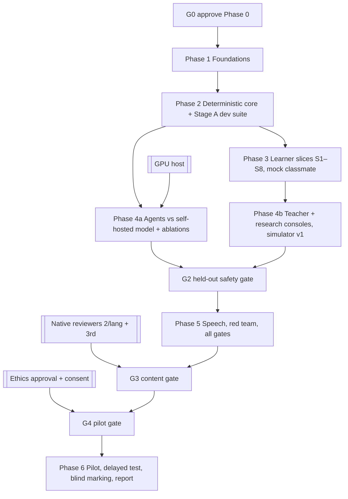

# Implementation plan

Capacity: **one developer + Claude** (decision D4). The paper assumed four people × ~10 h/day for four weeks [P-PLAN-01]; that assumption is not used here. Estimates are rough working weeks and will be re-estimated after Phase 1.

## 1. Dependency graph

The external tracks (reviewers, ethics, GPU) should start **at G0**, because they are the critical path, not the code.

## 2. Phases

### Phase 1: Foundations (~2 weeks)

| Slice | Spec IDs | Main files | Tests |
|---|---|---|---|
| 1.1 Move the Streamlit app to `legacy/` (still runnable); scaffold `setu/{domain,content,agents,store,web,research,export,speech}`; Python ≥ 3.11; Docker Compose with Postgres 16; CI | E-09, X-RULES-02 | `pyproject.toml`, `compose.yaml`, `.github/workflows/ci.yml` | legacy suite still green |
| 1.2 Schema + Alembic; DB roles and grants; ledger trigger | P-ARCH-11, E-01, E-02 | `setu/store/models.py`, `migrations/` | TS-DB-*, TS-AUTH-04 |
| 1.3 OutcomeWriter + Verdict / TeacherResolution types | P-SESS-11, X-RULES-06 | `setu/store/outcome_writer.py` | TS-AUTH-01..05 |
| 1.4 Content YAML schemas, validator CLI, importer (both repos, all `uncertain` / `draft`), data-source register table | P-BANK-01..07, X-BANK-*, X-DSR, E-06 | `setu/content/*`, `content/` | TS-BANK-*, TS-DSR-* |
| 1.5 Auth (handle + passphrase), roles, consent | E-08, P-ETH-04 | `setu/web/auth.py` | TS-AUTHN-*, TS-PRIV-01 |
| 1.6 Hindi catalog + Latin lint; base templates; self-hosted fonts | X-NOENG, E-03 | `locale/hi.yaml`, `templates/` | TS-L10N-01..02 |

### Phase 2: Deterministic core (~3 weeks)

| Slice | Spec IDs | Tests |
|---|---|---|
| 2.1 Normaliser (NFC, script bridge with disclosed forgiveness, IndicXlit adapter) | P-ARCH-05, P8b-06 | TS-NORM-* |
| 2.2 Checker v1 (4 verdicts, precedence, anchored patterns, near-miss, concept key) | P-ARCH-06, P-LSP-02 | TS-CHK-*, TS-WHY-* |
| 2.3 Tokenizer v1, TMR, leveler v0 | P-DIFF-01/03, E-16 | TS-TMR-*, TS-LEV-* |
| 2.4 Leak filter v1 and the three tools | P-CLS-03..08, P-TOOL-* | TS-LEAK-*, TS-TOOL-* |
| 2.5 Classmate state service; planner (seeded, error-weighted, no-error control) | P-CLS-*, P-ARCH-02, P8b-03, R-17 | TS-CLS-*, TS-PLAN-* |
| 2.6 Scheduler: py-fsrs, Beta / half-life tracker, BKT and SM-2 baselines | P-ARCH-12, E-04/05 | TS-SCHED-* |
| 2.7 Stage-A suite to ≥ 150 cases; freeze the held-out manifest; scorecard v1; OKF export | P-EVAL-01..03, E-17, X-MEM-03 | TS-SUITE-*, TS-OKF-*, TS-SCORE-01 |

### Phase 3: Learner slices (~5 weeks)

Each slice is one learner outcome, end to end, in Hindi.

| Slice | Outcome | Spec IDs |
|---|---|---|
| S1 | L0 script orientation and beginner onboarding | X-LAD-L0, P8b-04 |
| S2 | L1 akshara (signs, gunintalu, typing) | X-LAD-L1 |
| S3 | L2 words with FSRS, cognates and false friends | X-LAD-L2, X-BEG-02 |
| S4 | L3 chunks in the 4 scenes | X-LAD-L3, X-BEG-04 |
| S5 | L4 correction exchange (mock classmate, fixed hints, no-error turns, why, own sentence) | P-SESS-*, F-EXCH, F-OWN |
| S6 | Review-due re-teaching | P-LSP-03, F-REV |
| S7 | Ladder view and placement test-out | X-PERS-03/08 |
| S8 | L5 scenes with the bank-only friend | X-LAD-L5 |

Tests: TS-L0..L5, TS-SESS-*, TS-EXCH-*, TS-OWN-*, TS-UI-*, TS-E2E-*, TS-A11Y-*.

### Phase 4: Agents and consoles (~3–4 weeks)

- **4a:** self-hosted client; classmate tool loop; prompt-only and resampling baselines; coach LLM (flag); friend LLM (gated); model bake-off; red team on live output.
- **4b:**
  - teacher console F1–F8;
  - research console: study A/B/C with the defects fixed, balanced Latin square, test pools, blinded export;
  - simulator v1 with 60 baseline runs and ablations;
  - TE→HI end to end, with mirror mode behind a flag.

### Amendment A1 work (adds ~3–4 weeks in total)

| Where | Slice | Spec IDs |
|---|---|---|
| Phase 1 | Memory tables in the schema; `cue_level` on attempts; catalog `raju.*` templates; Raju turn-type enum | X-MEM-AID-06/12, X-RAJU-01/02 |
| Phase 2 | Student-only filter and new tool reasons; grounding validator; fact-sheet builder; FSRS cue cap; cue-ladder service | X-RAJU-03, X-MEM-AID-04/11/13 |
| Phase 3 | S1–S3 use **non-generative fallback aids** (twin view, decomposition, cognate link, reconstruction) plus native audio where available; aid events and fading end to end | X-MEM-AID-02/07/09/11/12 |
| Phase 4 | Offline aid pipeline (separate environment, budget, OCR, image generation, review queue F9); policy ranking and per-aid measurement; teacher-model recommendation behind a flag; Study M machinery; simulator aid parameters | X-MEM-AID-03/05/08/10, X-MEM-EXP-* |
| Phase 5 | G-MEM-ASSET / G-MEM-GROUND runs; Raju persona red team (M-56) | Gates |
| Phase 6 | Study M (separate recruitment, 30-day follow-up) after G-MEM-EXP | X-MEM-EXP-01..03 |

### Phase 5: Speech and gates (~2 weeks)

- ASR/TTS adapters behind flags, with WER vs Whisper.
- Native audio for the top 100 items, once consented.
- Full red team.
- Held-out scorecard run, then the G2/G2b decision.

### Phase 6: Pilot (depends on external parties)

Requires G3 (native review) and G4 (ethics). Then:
- 5–8 interviews;
- 5 learners in a Latin square;
- one-week delayed and transfer tests;
- blind marking with κ;
- Hedges' g with CIs;
- an honest report covering failures and anything not run.

## 3. Release gates

As in [metrics-and-gates.md](../research/metrics-and-gates.md) §2. If a safety-critical gate fails, the next major phase does not start [X-AFTER-8].

## 4. Legacy migration (nothing is deleted without a reason) [X-RULES-02]

| Legacy feature (setu-tutor) | Decision | Reason | Migration path |
|---|---|---|---|
| Streamlit pages (`app.py`, `web/*`) | Retire after S1–S5 reach parity | Limited control over Hindi-only UI, auth and multi-user use | Kept runnable in `legacy/` until parity |
| Terminal CLI (`setu/cli.py`) | Replace | Dev tool | `setu research cli` on the new engine |
| Engine (`tutor.py`), checker, leak filter, Raju state | Refactor into `setu/domain` | The core ideas are sound; precedence and hint bugs are fixed | Port with the legacy tests rewritten |
| Letter units L0-01..24, words L1-01..06 | Migrate as draft content | Valuable; unreviewed | Importer → YAML |
| Rule bank (15 / 29) | Merge with the LMA bank | Duplicate copies with different fields | Importer; DQ register |
| Didi Q&A to the model | **Remove** | Sends learner text to a commercial API; not answer-safe | Approved hints; "सवाल पूछें" → teacher queue later |
| AI tricks and pictures (`aids.py`, Nano Banana, SVG) | **Refactor into the offline aid pipeline** (amendment A1, ADR-0005) | The runtime versions were unreviewed, slow and gimmicky; the ideas (font overlay, SVG sanitiser, text check) are useful | Offline generation → validators → teacher review → library; no runtime generation |
| Ravi scene lines | Replace | Unreviewable model text | Approved scene scripts; LLM friend behind a gate |
| Balloons, emoji, celebrating persona | **Remove** | X-CALM | — |
| Model-written Raju lines and reactions (`writer.py`) | **Replace** | Assistant drift; ADR-0006 | Fixed `raju.*` catalog templates; the model fills only the sentence slot |
| Settings dev controls (time travel, reset, jump) | Move | No auth; unsafe for learners | Researcher console, audited |
| Gemini / Google AI Studio clients (`llm.py`) | **Remove** | D3 privacy | OpenAI-compatible client only |
| Offline hook drafting (`scripts/draft_hooks.py`) | Keep as an offline tool | Drafts go to review only | Point it at the self-hosted model |
| JSON learner store, jsonl queue | Replace | No DB, races | Postgres; dev records are not migrated |
| LMA hosted JS app | Retire | A duplicate implementation | Golden-file tests replace parity |

## 5. Risks (implementation)

R-17, R-18, R-19, R-20 and R-21 are tracked in the matrix §16. The highest-leverage mitigation is to start native review and ethics paperwork at G0.

## 6. Slice protocol and milestone reports [X-AFTER]

**Before each slice**, post:
- spec IDs;
- files to change;
- dependencies;
- risks;
- tests to write first.

**After each slice**, update the matrix lifecycle columns.

**Each milestone report** has these sections:

| Section |
|---|
| Implemented |
| Tested (with actual output) |
| Not implemented |
| Blocked |
| Measured (scorecard excerpt) |
| Failed |
| Next decisions |

**Definition of done** [X-DOD]. A feature is done only when all of these hold:
1. it has a spec and a traceability ID;
2. the learner outcome and its evidence are defined;
3. the UI is Hindi-only;
4. contracts, permissions and failure states are implemented;
5. acceptance and adversarial tests pass;
6. all model output is validated;
7. only OutcomeWriter writes state;
8. uncertain cases go to teacher review;
9. telemetry exists for its metric;
10. docs are updated;
11. its gate is passed, or it is flagged `built_not_evaluated`.

## 7. Progress log

| Slice | Status | Evidence |
|---|---|---|
| 1.1 Scaffold, legacy move, Compose, CI | **Built and tested** (31 Oct 2026) | New suite: 4 passed (package imports, domain has no I/O imports, `/healthz`, no commercial model client). Legacy suite from `legacy/`: 138 passed on Python 3.11. `ruff check .` clean. `docker compose config` valid. **Not verified:** the Compose stack was not started (Docker daemon not running) and CI has not run (no remote configured). Known warning: Starlette deprecates its httpx-based TestClient (third-party; left as is) |
| 1.2 Schema, Alembic, roles and grants, ledger | **Built and tested** (31 Oct 2026) | 48 tables (migration `0001`). New suite 70 passed, including 66 real-Postgres tests: constraints and rule-approval guards, the grant matrix (incl. real login users), append-only hash-chained ledger (incl. tamper detection and 6 concurrent writers), immutability, migration round trip, models in sync with migration. Legacy suite 138 passed. Lint clean. Deviations recorded in data-model.md §9. Not verified: CI has not run (no remote) |
