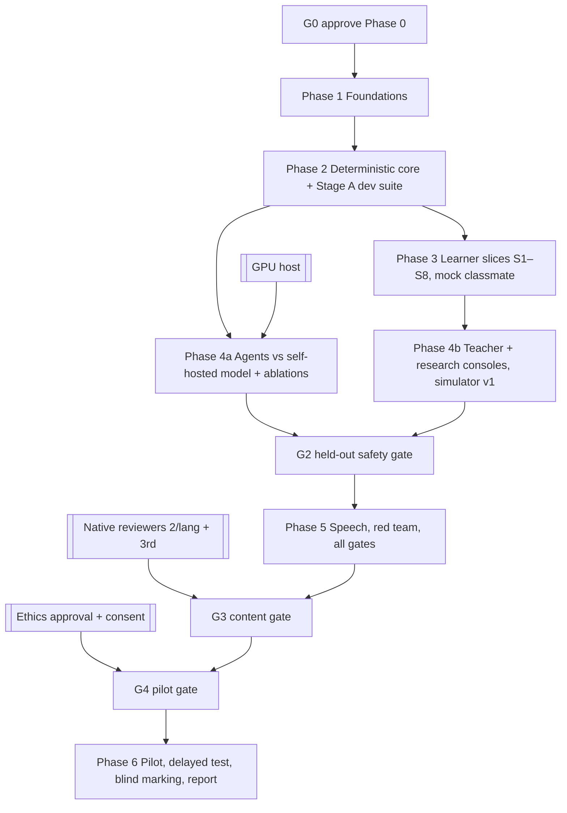

# Implementation plan

Capacity: **one developer + Claude** (decision D4). The paper assumed four people × ~10 h/day for four weeks [P-PLAN-01]; that assumption is not used here. Estimates are rough working weeks and will be re-estimated after Phase 1.

## 1. Dependency graph

The external tracks (reviewers, ethics, GPU) should start **at G0**, because they are the critical path, not the code.

## 2. Phases

### Phase 1: Foundations (~2 weeks)

| Slice | Spec IDs | Main files | Tests |
|---|---|---|---|
| 1.1 Move the Streamlit app to `legacy/` (still runnable); scaffold `setu/{domain,content,agents,store,web,research,export,speech}`; Python ≥ 3.11; Docker Compose with Postgres 16; CI | E-09, X-RULES-02 | `pyproject.toml`, `compose.yaml`, `.github/workflows/ci.yml` | legacy suite still green |
| 1.2 Schema + Alembic; DB roles and grants; ledger trigger | P-ARCH-11, E-01, E-02 | `setu/store/models.py`, `migrations/` | TS-DB-*, TS-AUTH-04 |
| 1.3 OutcomeWriter + Verdict / TeacherResolution types | P-SESS-11, X-RULES-06 | `setu/store/outcome_writer.py` | TS-AUTH-01..05 |
| 1.4 Content YAML schemas, validator CLI, importer (both repos, all `uncertain` / `draft`), data-source register table | P-BANK-01..07, X-BANK-*, X-DSR, E-06 | `setu/content/*`, `content/` | TS-BANK-*, TS-DSR-* |
| 1.5 Auth (handle + passphrase), roles, consent | E-08, P-ETH-04 | `setu/web/auth.py` | TS-AUTHN-*, TS-PRIV-01 |
| 1.6 Hindi catalog + Latin lint; base templates; self-hosted fonts | X-NOENG, E-03 | `locale/hi.yaml`, `templates/` | TS-L10N-01..02 |

### Phase 2: Deterministic core (~3 weeks)

| Slice | Spec IDs | Tests |
|---|---|---|
| 2.1 Normaliser (NFC, script bridge with disclosed forgiveness, IndicXlit adapter) | P-ARCH-05, P8b-06 | TS-NORM-* |
| 2.2 Checker v1 (4 verdicts, precedence, anchored patterns, near-miss, concept key) | P-ARCH-06, P-LSP-02 | TS-CHK-*, TS-WHY-* |
| 2.3 Tokenizer v1, TMR, leveler v0 | P-DIFF-01/03, E-16 | TS-TMR-*, TS-LEV-* |
| 2.4 Leak filter v1 and the three tools | P-CLS-03..08, P-TOOL-* | TS-LEAK-*, TS-TOOL-* |
| 2.5 Classmate state service; planner (seeded, error-weighted, no-error control) | P-CLS-*, P-ARCH-02, P8b-03, R-17 | TS-CLS-*, TS-PLAN-* |
| 2.6 Scheduler: py-fsrs, Beta / half-life tracker, BKT and SM-2 baselines | P-ARCH-12, E-04/05 | TS-SCHED-* |
| 2.7 Stage-A suite to ≥ 150 cases; freeze the held-out manifest; scorecard v1; OKF export | P-EVAL-01..03, E-17, X-MEM-03 | TS-SUITE-*, TS-OKF-*, TS-SCORE-01 |

### Phase 3: Learner slices (~5 weeks)

Each slice is one learner outcome, end to end, in Hindi.

| Slice | Outcome | Spec IDs |
|---|---|---|
| S1 | L0 script orientation and beginner onboarding | X-LAD-L0, P8b-04 |
| S2 | L1 akshara (signs, gunintalu, typing) | X-LAD-L1 |
| S3 | L2 words with FSRS, cognates and false friends | X-LAD-L2, X-BEG-02 |
| S4 | L3 chunks in the 4 scenes | X-LAD-L3, X-BEG-04 |
| S5 | L4 correction exchange (mock classmate, fixed hints, no-error turns, why, own sentence) | P-SESS-*, F-EXCH, F-OWN |
| S6 | Review-due re-teaching | P-LSP-03, F-REV |
| S7 | Ladder view and placement test-out | X-PERS-03/08 |
| S8 | L5 scenes with the bank-only friend | X-LAD-L5 |

Tests: TS-L0..L5, TS-SESS-*, TS-EXCH-*, TS-OWN-*, TS-UI-*, TS-E2E-*, TS-A11Y-*.

### Phase 4: Agents and consoles (~3–4 weeks)

- **4a:** self-hosted client; classmate tool loop; prompt-only and resampling baselines; coach LLM (flag); friend LLM (gated); model bake-off; red team on live output.
- **4b:**
  - teacher console F1–F8;
  - research console: study A/B/C with the defects fixed, balanced Latin square, test pools, blinded export;
  - simulator v1 with 60 baseline runs and ablations;
  - TE→HI end to end, with mirror mode behind a flag.

### Amendment A1 work (adds ~3–4 weeks in total)

| Where | Slice | Spec IDs |
|---|---|---|
| Phase 1 | Memory tables in the schema; `cue_level` on attempts; catalog `raju.*` templates; Raju turn-type enum | X-MEM-AID-06/12, X-RAJU-01/02 |
| Phase 2 | Student-only filter and new tool reasons; grounding validator; fact-sheet builder; FSRS cue cap; cue-ladder service | X-RAJU-03, X-MEM-AID-04/11/13 |
| Phase 3 | S1–S3 use **non-generative fallback aids** (twin view, decomposition, cognate link, reconstruction) plus native audio where available; aid events and fading end to end | X-MEM-AID-02/07/09/11/12 |
| Phase 4 | Offline aid pipeline (separate environment, budget, OCR, image generation, review queue F9); policy ranking and per-aid measurement; teacher-model recommendation behind a flag; Study M machinery; simulator aid parameters | X-MEM-AID-03/05/08/10, X-MEM-EXP-* |
| Phase 5 | G-MEM-ASSET / G-MEM-GROUND runs; Raju persona red team (M-56) | Gates |
| Phase 6 | Study M (separate recruitment, 30-day follow-up) after G-MEM-EXP | X-MEM-EXP-01..03 |

### Phase 5: Speech and gates (~2 weeks)

- ASR/TTS adapters behind flags, with WER vs Whisper.
- Native audio for the top 100 items, once consented.
- Full red team.
- Held-out scorecard run, then the G2/G2b decision.

### Phase 6: Pilot (depends on external parties)

Requires G3 (native review) and G4 (ethics). Then:
- 5–8 interviews;
- 5 learners in a Latin square;
- one-week delayed and transfer tests;
- blind marking with κ;
- Hedges' g with CIs;
- an honest report covering failures and anything not run.

## 3. Release gates

As in [metrics-and-gates.md](../research/metrics-and-gates.md) §2. If a safety-critical gate fails, the next major phase does not start [X-AFTER-8].

## 4. Legacy migration (nothing is deleted without a reason) [X-RULES-02]

| Legacy feature (setu-tutor) | Decision | Reason | Migration path |
|---|---|---|---|
| Streamlit pages (`app.py`, `web/*`) | Retire after S1–S5 reach parity | Limited control over Hindi-only UI, auth and multi-user use | Kept runnable in `legacy/` until parity |
| Terminal CLI (`setu/cli.py`) | Replace | Dev tool | `setu research cli` on the new engine |
| Engine (`tutor.py`), checker, leak filter, Raju state | Refactor into `setu/domain` | The core ideas are sound; precedence and hint bugs are fixed | Port with the legacy tests rewritten |
| Letter units L0-01..24, words L1-01..06 | Migrate as draft content | Valuable; unreviewed | Importer → YAML |
| Rule bank (15 / 29) | Merge with the LMA bank | Duplicate copies with different fields | Importer; DQ register |
| Didi Q&A to the model | **Remove** | Sends learner text to a commercial API; not answer-safe | Approved hints; "सवाल पूछें" → teacher queue later |
| AI tricks and pictures (`aids.py`, Nano Banana, SVG) | **Refactor into the offline aid pipeline** (amendment A1, ADR-0005) | The runtime versions were unreviewed, slow and gimmicky; the ideas (font overlay, SVG sanitiser, text check) are useful | Offline generation → validators → teacher review → library; no runtime generation |
| Ravi scene lines | Replace | Unreviewable model text | Approved scene scripts; LLM friend behind a gate |
| Balloons, emoji, celebrating persona | **Remove** | X-CALM | — |
| Model-written Raju lines and reactions (`writer.py`) | **Replace** | Assistant drift; ADR-0006 | Fixed `raju.*` catalog templates; the model fills only the sentence slot |
| Settings dev controls (time travel, reset, jump) | Move | No auth; unsafe for learners | Researcher console, audited |
| Gemini / Google AI Studio clients (`llm.py`) | **Remove** | D3 privacy | OpenAI-compatible client only |
| Offline hook drafting (`scripts/draft_hooks.py`) | Keep as an offline tool | Drafts go to review only | Point it at the self-hosted model |
| JSON learner store, jsonl queue | Replace | No DB, races | Postgres; dev records are not migrated |
| LMA hosted JS app | Retire | A duplicate implementation | Golden-file tests replace parity |

## 5. Risks (implementation)

R-17, R-18, R-19, R-20 and R-21 are tracked in the matrix §16. The highest-leverage mitigation is to start native review and ethics paperwork at G0.

## 6. Slice protocol and milestone reports [X-AFTER]

**Before each slice**, post:
- spec IDs;
- files to change;
- dependencies;
- risks;
- tests to write first.

**After each slice**, update the matrix lifecycle columns.

**Each milestone report** has these sections:

| Section |
|---|
| Implemented |
| Tested (with actual output) |
| Not implemented |
| Blocked |
| Measured (scorecard excerpt) |
| Failed |
| Next decisions |

**Definition of done** [X-DOD]. A feature is done only when all of these hold:
1. it has a spec and a traceability ID;
2. the learner outcome and its evidence are defined;
3. the UI is Hindi-only;
4. contracts, permissions and failure states are implemented;
5. acceptance and adversarial tests pass;
6. all model output is validated;
7. only OutcomeWriter writes state;
8. uncertain cases go to teacher review;
9. telemetry exists for its metric;
10. docs are updated;
11. its gate is passed, or it is flagged `built_not_evaluated`.

## 7. Progress log

| Slice | Status | Evidence |
|---|---|---|
| 1.1 Scaffold, legacy move, Compose, CI | **Built and tested** (31 Oct 2026) | New suite: 4 passed (package imports, domain has no I/O imports, `/healthz`, no commercial model client). Legacy suite from `legacy/`: 138 passed on Python 3.11. `ruff check .` clean. `docker compose config` valid. **Not verified:** the Compose stack was not started (Docker daemon not running) and CI has not run (no remote configured). Known warning: Starlette deprecates its httpx-based TestClient (third-party; left as is) |
| 1.2 Schema, Alembic, roles and grants, ledger | **Built and tested** (31 Oct 2026) | 48 tables (migration `0001`). New suite 70 passed, including 66 real-Postgres tests: constraints and rule-approval guards, the grant matrix (incl. real login users), append-only hash-chained ledger (incl. tamper detection and 6 concurrent writers), immutability, migration round trip, models in sync with migration. Legacy suite 138 passed. Lint clean. Deviations recorded in data-model.md §9. Not verified: CI has not run (no remote) |
| 1.3 OutcomeWriter, Verdict, TeacherResolution, ForgetDecision | **Built and tested** (31 Oct 2026) | New suite 109 passed: authority tests (verdicts cannot be constructed, mutated, copied or forged; only the checker mints them; agents, memory, speech, domain and the offline pipeline cannot import the writer; resolutions are HMAC-signed and re-checked against the teacher's role) and real-Postgres writer tests (the classmate learns only from a checked correct fix of a planted error — never from wrong, partial, unsure, why-answers, no-error or own-sentence verdicts; unsure goes to the teacher queue and changes nothing; idempotent recording; forgetting only below 0.5; teacher resolutions; direct SQL as `setu_writer` cannot teach, forget, skip versions or replay old evidence). Legacy 138 passed. Lint clean. **Scope note:** mastery and FSRS writes arrive with the tracker in slice 2.6; `issue_verdict` is the checker's temporary public minting function until the real checker (slice 2.2) replaces it with `check()`. Python cannot make a constructor truly private; the guarantees rest on the import-boundary tests, the database grants and the classmate-state trigger together |
| 1.4 Content schemas, validator CLI, importer, data-source register | **Built and tested** (31 Oct 2026) | New suite 190 passed. **Patterns:** 38 adversarial tests (parse-level anchoring, top-level alternation, escaped `$`, `\Z`, wildcards, lookarounds, backreferences, nested and large repeats, empty match, inline flags, newlines, wrong script; semantic checks for fragments, wrong forms and correct forms; one-error spans). **Content:** both repos converted with lossless provenance (raw records + sha256, checked against the sources), conversion reproducible against `content/CONVERSION.json`, nothing claims review or approval, no Latin in learner-facing fields. **Import (real Postgres):** 25 rule versions, 49 item versions, 22 proposed variants, 28 words, 5 scenes, 24 data sources; re-import adds nothing; changes create new versions and keep history; versions under review are never superseded; erroneous trees write nothing; runs as `setu_content`. **Guards (migration 0003):** no Latin in learner-facing columns, anchored patterns, no approval with open issues, no verification without learner text; learner views show nothing until content is verified and teacher-approved, and `setu_read` can no longer read draft tables. CLI run end to end against the dev database. Legacy 138 passed. Lint clean. Team consent for vendoring the LMA data snapshot confirmed 31 Oct 2026 (ADR-0001) |
| 1.5 Pseudonymous accounts, roles, consent, withdrawal | **Built and tested** (31 Oct 2026) | New suite 216 passed. **Accounts:** single-use, expiring invite codes (hash stored); random numeric handles; argon2id passphrases with a length policy; HttpOnly + Secure + SameSite=Lax cookies with only the token hash stored; logout revokes; failed logins look identical for unknown handles; lockout after 5 failures in 15 minutes per handle; no IPs stored; no name, email or phone columns. **Roles:** researchers invite learners and teachers, only admins invite privileged roles; learners and teachers are refused research routes. **Consent:** form version and scopes recorded; the database refuses sessions without active consent and study or test sessions without the pilot scope. **Withdrawal:** raw learner text redacted, background deleted, sessions revoked, new sessions refused; ledger intact and free of learner text. Earlier fixtures now give their learners consent. Legacy 138 passed. Lint clean. Dev database upgraded to 0004. Deviation (ledger not anonymised) recorded in data-model.md §9 |
| 1.6 Hindi catalog, Latin lint, base templates, fonts | **Built and tested** (31 Oct 2026) | New suite 256 passed. Catalog lint and visible-text template lint with adversarial snippets; every template key and API error code has Hindi text; missing, pending and Latin-parameter lookups fail; rendered pages crawled for Latin, emoji, external resources, `lang="hi"` and `lang="te"` on Telugu; fonts served locally; consent cannot be signed through the page or the API until the approved text exists. JSON API moved under `/api`. Real server smoke test over HTTP. Legacy 138 passed. Lint clean |

## 8. Milestone report: Phase 1 (Foundations), 31 Oct 2026

| Heading | Content |
|---|---|
| **Implemented** | 1.1 scaffold and legacy move; 1.2 schema (48 tables, 4 migrations), roles and grants, append-only hash-chained ledger; 1.3 OutcomeWriter with checker verdicts, signed teacher resolutions and scheduler forget decisions, plus the classmate-state trigger; 1.4 content conversion (both repos, lossless provenance), validator, importer, learner-visible views; 1.5 pseudonymous accounts, roles, consent and withdrawal; 1.6 Hindi catalog, lint, base pages, self-hosted fonts |
| **Tested** | 256 new tests pass (unit plus real Postgres 16); legacy 138 pass; ruff and the Hindi lint clean; dev database migrated to 0004 with all content imported as drafts; real server smoke test |
| **Not implemented** (by plan, later phases) | Normaliser, checker logic, leak filter, planner, scheduler (Phase 2); learner slices (Phase 3); agents, consoles, simulator (Phase 4); speech and gates (Phase 5) |
| **Blocked** | CI has never run (no git remote); ethics-approved Hindi consent text (gate G4); native-speaker review of every rule and word (gate G3); GPU host for model evaluation (Phase 4) |
| **Measured** | No metric from metrics-and-gates.md is measured yet (nothing learner-facing or model-facing exists). Content quality: 25 rules / 49 items / 28 words imported, 0 errors, 105 open issues blocking approval |
| **Failed** | Nothing failed its acceptance tests. Defects found and fixed along the way: leaked test databases (fixture cleanup), duplicated constraint prefixes in a downgrade, a misplaced colon in migration 0001, a `/consent` route collision, consent signable through the API before the approved text existed |
| **Deviations** | Recorded in data-model.md §9 (five roles; grant plans V1–V3; ledger not anonymised on withdrawal; learner-L1 columns named `_hi`; compose port 5433), localisation-hindi-ui.md §7 (lint checks visible content), api-and-tool-contracts.md Part B (`/api` prefix) |
| **Next decisions** | (1) Confirm the `/api` prefix and the five-role model. (2) Whether withdrawal should also delete learning state (ethics protocol). (3) Push to a remote so CI runs. (4) Start Phase 2 with slice 2.1 (normaliser) |
**Update 31 Oct 2026 (ADR-0007):** the user confirmed the `/api` prefix and the five-role model, and decided that consent is collected in person. The in-app consent page and endpoints were removed; registration records the in-person consent. First CI run on GitHub (run 41125253233) passed both jobs, so "CI never ran" is resolved. New suite 253 passed after the change.
| 2.1 Normaliser | **Built and tested** (31 Oct 2026) | New suite 291 passed (38 normaliser tests: canonical form, Devanagari typing, name-built conversion table, reported notes and unconvertible characters, forgiveness only for Hindi-keyboard input and always reported, romanised input flagged or transliterated into validated candidates, mixed and foreign scripts flagged, TE→HI conversion, explanations untouched, lossless round trip over all content forms and 500 random strings). Legacy 138 passed. Lint clean. Behaviour change from legacy: e/o length is no longer forgiven for Telugu-typed answers. IndicXlit model not wired in (adapter only) |
| 2.2 Checker v1 and input-method contracts (R-INPUT) | **Built and tested** (31 Oct 2026) | New suite 346 passed. Checker: 41 tests (four verdicts in the specified order, fragments never correct, planted words caught even without patterns, near misses only when clearly closer to the answer, unreadable and romanised input unsure, empty answers wrong, no-error turns and false alarms, multiple choice as recognition, closed and open recall, explanation scoring on whole words with relations). Database (migration 0005): `response_mode` and `assistance` on every attempt, cue level tied to recall cues, multiple choice and tiles must record their aids, `recognition` verdicts, the classmate learns only from independent cue-free fixes (writer and trigger), FSRS log cue level tied to the attempt; 16 tests. Verdict minting is now private to the checker. The migration round-trip test runs on its own database. Dev database upgraded to 0005. Legacy 138 passed. Lint and Hindi lint clean. R-INPUT specified in session-and-exchange §11, data model, methodology, experiment protocol §9, PRD §9, matrix §26 and test plan §6; interaction components in Phase 3 |
| 2.3 Tokenizer, TMR, leveler v0 | **Built and tested** (31 Oct 2026) | New suite 362 passed. Tokenizer-1 (surface forms, no clitic split); TMR per paper Eq. 1 with exempt target forms and numbers; leveler v0 = hardest assessed dimension, with reasons; script and structure computed; vocabulary and word forms reported unassessed (no frequency ranks or analyser yet), so labels are marked incomplete; learner-relative unknown letters and TMR; imported items now carry band, reason and leveler version. Legacy 138 passed. Lint and Hindi lint clean. Known gap: the 49 item versions already in the dev database have no band until they change or the database is rebuilt |
| 2.4 Leak filter v1 and read-only tools | **Built and tested** (31 Oct 2026) | New suite 396 passed. 34 tests: planted turns only accept the approved planted sentence; answer leaks, unseen words (target forms exempt), unknown-rule and wrong-rule sentences rejected; no-error and retry turns must be exactly right; the student-only filter rejects assistant and teacher register, glosses, formatting, emoji, multiple sentences, length, unsafe instructions and wrong script; hints with the answer in Telugu or Devanagari are rejected; `check_level` reports out-of-vocabulary share, Hindi share and band; the JSON envelope returns the exact documented errors and runs only read-only checks. DQ-08: six rule titles flagged as revealing answers (126 issues in total). Legacy 138 passed. Lint and Hindi lint clean |
| 2.5 Planner and seen-word view | **Built and tested** (31 Oct 2026) | New suite 408 passed. Planner: deterministic per seed; only learner-ready, plantable, classmate-unknown/forgotten rules planted at band b/b+1; forgotten rules first; error-weighted choice; no-error share 15–25% over 400 seeds and only on rules the classmate knows; production instead of no-error turns when nothing can be planted (R-17); classmate start threshold; at most two turns in a row on one rule; invalid configs refused. `classmate_vl` view (migration 0006) from word cards and shown items. Dev database at 0006. Legacy 138 passed. Lint clean |
| 2.6 Scheduler: FSRS, mastery tracker, unlock rule, baselines, forgetting | **Built and tested** (31 Oct 2026) | New suite 441 passed. 27 unit tests (FSRS ratings with the cue cap, deterministic reviews, Beta quantiles, tracker updates and decay, assisted or revealed answers not counted, predicted recall and forget decisions, unlock rule cases, BKT, SM-2, log-loss, AUC) and 6 database tests (the OutcomeWriter updates the FSRS card, review log and skill in one transaction; assisted answers capped at Hard and not counted; unsure changes nothing; varied evidence over two days masters a skill; skill evidence is immutable and writer-only; the classmate forgets when the learner's predicted recall drops below 0.5). Migration 0007; dev database at 0007. Legacy 138 passed. Lint clean. Gap: imported rules have no `target_skill_id` yet, so forgetting needs the skill graph (Phase 3) |
| 2.7 Stage A suite, scorecard v1, OKF export | **Built and tested** (31 Oct 2026) | New suite 928 passed (including 478 dev Stage-A cases). 663 generated cases with a frozen 30% held-out manifest; scorecard v1 against frozen thresholds, writing Markdown and JSON reports; first held-out run: five measured metrics pass, **M-09 unsure rate 0.182 fails (target 0.15)**, 13 not measured with reasons; OKF export and `GET /api/export/okf`. Legacy 138 passed. Lint and Hindi lint clean |

## 9. Milestone report: Phase 2 (deterministic core), 31 Oct 2026

| Heading | Content |
|---|---|
| **Implemented** | 2.1 normaliser; 2.2 checker v1 and input-method contracts (R-INPUT); 2.3 tokenizer, TMR, leveler v0; 2.4 leak filter and read-only tools; 2.5 planner and the classmate's seen words; 2.6 FSRS, mastery tracker, unlock rule, baselines, forgetting; 2.7 Stage A suite, scorecard, OKF export. Also ADR-0007 (consent in person, `/api`, roles) |
| **Tested** | 928 new tests pass (unit, real Postgres, 478 dev Stage-A cases); legacy 138; ruff and the Hindi lint clean; first CI run on GitHub passed (later commits not yet pushed) |
| **Not implemented** (by plan) | Learner pages and interaction components (Phase 3); agents with a model, consoles, simulator (Phase 4); speech (Phase 5) |
| **Blocked** | Native review of all rules and words (G3); teacher labels for checker agreement (M-16); IndicCorp frequency ranks and the analyser (leveler dimensions); a GPU host for model evaluation |
| **Measured** | Held-out scorecard: M-05 1.00, M-07 1.00, M-08 0.00, M-14 0, M-54 0 (pass); **M-09 0.182 (fail)**; 13 gate metrics not measured. All numbers come from team-generated cases and are optimistic |
| **Failed** | M-09 unsure rate. Not relaxed, and the checker was not tuned on its held-out cases |
| **Deviations** | Planted turns accept only the approved planted sentence (stricter than "exactly one error"); only independent, cue-free fixes teach the classmate (stricter than "multiple choice alone"); leveler vocabulary and word forms unassessed; reading aid and prompt audio are presentation aids, not cues; imported rules have no `target_skill_id`, so forgetting needs the skill graph |
| **Next decisions** | (1) Whether to adopt the "incomplete answer → wrong" rule for M-09 after teacher labelling. (2) Start Phase 3 with slice S1 (L0 script orientation), which builds the skill graph and `target_skill_id`s. (3) Push the Phase 2 commits so CI runs |
| S1 L0 script orientation and letters | **Built and tested** (31 Oct 2026) | New suite 943 passed. Migration 0008 (`letter` with a two-approval check, `learner_letter` view, `exchange.task`; grant plan V5); importer-2 creates letters, the L0 skill graph and rule `target_skill_id`s (new versions, not edits; dev DB re-imported: 25 rule and 49 item versions, all with skills and bands); orientation and practice pages in Hindi with on-screen keyboards; answers go only through the checker and the OutcomeWriter. Nothing is visible to learners until letters are natively approved. Legacy 138 passed; lints clean |
