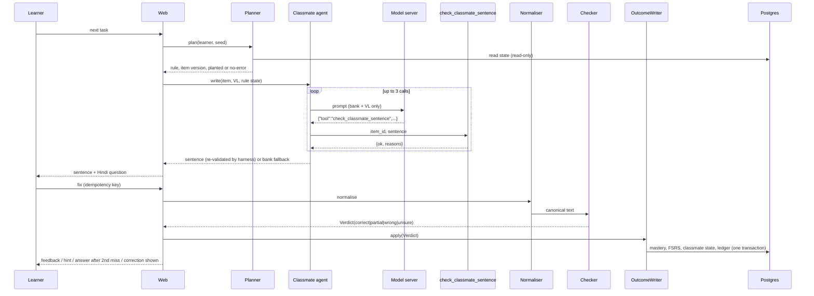
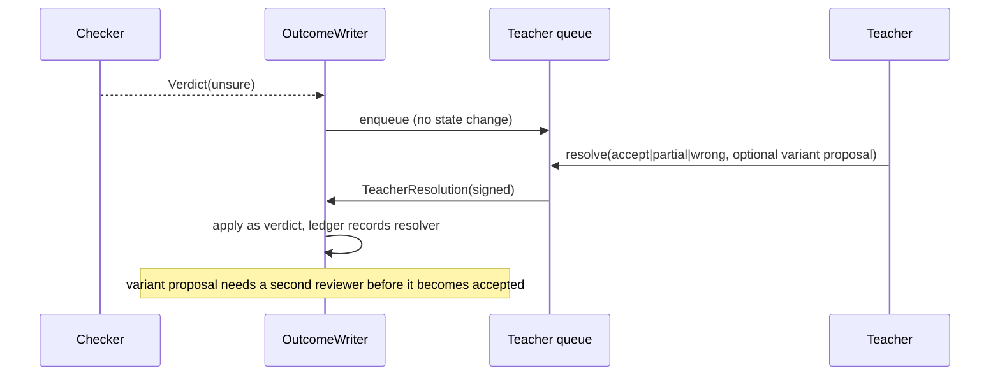
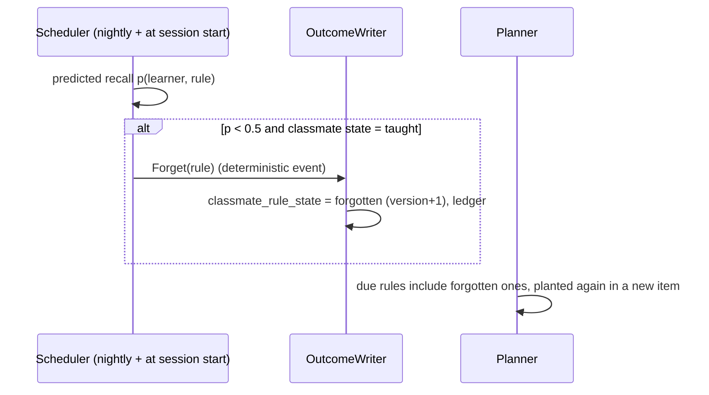

# Architecture

Decisions: FastAPI + PostgreSQL + Jinja/HTMX (ADR-0002); self-hosted models only (ADR-0003); writers separated from deciders (ADR-0004). Tags: [P] paper · [X] prompt extension · [E] engineering recommendation.

## 1. Components

```mermaid
flowchart LR
  subgraph Browser["Browser (Hindi UI, HTMX)"]
    L[Learner pages]; T[Teacher console]; RS[Research console]
  end
  subgraph App["FastAPI app"]
    W[web routers + Hindi catalog]
    subgraph Domain["setu.domain (deterministic, no I/O)"]
      N[Normaliser]; C[Checker 4 verdicts]; F[Leak filter + TMR]
      PL[Planner]; SC[Scheduler: FSRS + tracker]; CS[Classmate state rules]; LV[Leveler v0]
    end
    subgraph Agents["setu.agents (LLM, read-only tools)"]
      CM[Classmate agent]; CO[Coach]; FR[Native friend]; TL[Tools: check_classmate_sentence, check_level, check_hint_has_no_answer, lookups]
    end
    OW[OutcomeWriter (only writer of learning state)]
    RR[ReadRepo (read-only role)]
    EX[OKF exporter]
  end
  DB[(Postgres: source of truth)]
  LLM[[Self-hosted OpenAI-compatible server: vLLM / Ollama / mock]]
  SP[[ASR / TTS services (flagged)]]
  W --> PL --> RR
  W --> CM --> TL --> F
  CM --> LLM
  CO --> LLM
  FR --> LLM
  W --> N --> C --> OW --> DB
  RR --> DB
  T --> W
  EX --> RR
  W -. flag .-> SP
```

| Component | Built with | LLM | Writes | Source |
|---|---|---|---|---|
| Planner | Deterministic selection over skill and rule state; seeded | No | `session`, `exchange` plan rows | P-ARCH-02 |
| Classmate agent | Prompt + JSON tool envelope; ≤ 3 calls | Yes | Nothing (returns text) | P-ARCH-03 |
| Coach | Fixed hints (Phase 3); LLM type choice and drafting (Phase 4, flag) | Phase 4 | Nothing | P-ARCH-07 |
| Native friend | Approved scripts (Phase 3); LLM with `check_level` (Phase 4, gate) | Phase 4 | Nothing | P-ARCH-08 |
| Normaliser | NFC, zero-width strip, Devanagari→Telugu bridge, IndicXlit adapter (pinned) | Small model (IndicXlit) | Nothing | P-ARCH-05 |
| Checker | Patterns, variants, near-miss, concept key, analyser adapter (Phase 4) | No | Nothing (returns a verdict) | P-ARCH-06 |
| Leak filter | VL, tokenizer v1, bank patterns, the checker | No | Nothing | P-ARCH-04 |
| OutcomeWriter | The only module holding `setu_writer` DB credentials | No | Mastery, FSRS, classmate state, ledger | P-ARCH-11, E-01 |
| Teacher resolution | Calls OutcomeWriter with a teacher-signed resolution | No | as above | P-ARCH-10 |
| Exporter | OKF Markdown + YAML from ReadRepo | No | Files only | X-MEM-03 |
| Speech | HTTP adapters to ASR/TTS, behind flags | ASR/TTS models | Audio assets (approved) | P-ARCH-13 |
| Contrast pipeline | Offline scripts → `content_proposal` (draft) | Optional | Proposals only | P-ARCH-15 |

## 2. Trust boundaries [P §9, X §6.3]

| Boundary | Rule | Enforcement |
|---|---|---|
| Learner text → system | Goes **only** to the normaliser and checker. The classmate prompt is built only from bank content and VL | Prompt builder takes typed bank objects; a test asserts learner strings never appear in `model_call.prompt` (TS-RED-05) |
| Learner text → coach / friend (Phase 4) | A delimited `<learner_text>` field, ≤ 300 chars, with an instruction that it is data; output still filtered | TS-RED-10..14 |
| Model output → display | Every output goes through validators: leak filter (classmate), `check_hint_has_no_answer` (coach), `check_level` (friend), display checks for all. Fallback: bank or approved line | TS-DISP-* |
| Model → state | No path. Agents get only ReadRepo and read-only tools. OutcomeWriter accepts only a `Verdict` produced by the checker (an internal type with a constructor private to the checker module) or a `TeacherResolution` signed by a teacher session | Code: types and import rules; DB: grants (E-01); test: TS-AUTH-01..05 |
| Uploaded learner writing | Produces `content_proposal` rows only; teacher approval is required to change the bank | TS-TCH-UP |
| Network egress | The runtime config allows only the configured self-hosted model URL and speech URLs; there is no commercial API client in the codebase | TS-PRIV-03 (egress allow-list test) |
| Roles | learner, teacher, researcher, admin. Dev controls (time travel, reset) are researcher-only and audited | TS-AUTHN-* |

## 3. Sequence: one correction exchange



## 4. Sequence: unsure → teacher



## 5. Sequence: forgetting and re-teaching



## 6. Failure paths

| Failure | Behaviour | Learner sees |
|---|---|---|
| Model server down or timeout (8 s per call) | Bank sentence; `model_call.error` logged | The exchange continues normally |
| 3 drafts rejected | Bank sentence; fallback counted (M-11) | Normal |
| Tool envelope malformed | Fixed error string to the model; counts as 1 call | Normal |
| Checker cannot decide | `unsure` → teacher queue | "शिक्षक देखेंगे — अभी गिना नहीं गया" |
| Hint fails validation | Fixed approved hint | Hint |
| Friend line fails `check_level` | Approved scene line | Scene line |
| DB write fails | Transaction rollback; the exchange stays pending (idempotent retry) | "कुछ गड़बड़ हुई — दोबारा भेजिए" |
| No active verified rules (content gate) | Classmate inactive; learn, review and own-sentence only | Hindi notice: "राजू अभी तैयार नहीं" |
| Gate failed for a module | Feature flag off (`built_not_evaluated`) | Feature absent |
| Injection text in a learner answer | Treated as text; the checker returns wrong or unsure | Normal verdict |

## 7. Speech extension (flagged) [P-ARCH-13, X-SPEECH]

- **ASR:** `POST /speech/asr` → an external IndicConformer service (Whisper as baseline). Word-level comparison only. The transcript is treated exactly like typed input (normaliser → checker), so no ASR text is trusted as correct.
- **TTS:** native recordings first (consented, with a rights record); Indic Parler-TTS for others, labelled internally as synthetic and only after speaker review.
- **Flags:** `speech_input`, `tts_synthetic`. Both are off until their gates pass (M-25, speaker review).

## 8. Deployment [E-09]

- Docker Compose with these services: `app` (Python ≥ 3.11, uvicorn), `db` (Postgres 16, with the roles `setu_read`, `setu_writer` and `setu_migrate`), and optionally `ollama` for development.
- Gemma 3 12B on a GPU host through vLLM for evaluations.
- Fonts are self-hosted (Noto Sans Telugu and Noto Sans Devanagari); there is no Google Fonts call.
- The CI runs ruff, pytest (unit, contract, adversarial, Stage-A dev split), the Hindi lint, and Playwright E2E against the mock model.

## 9. Repository layout after Phase 1

```
setu/            domain/ content/ agents/ store/ web/ research/ export/ speech/
content/         hi-te/{letters,akshara,lexicon,chunks,rules,scenes}/*.yaml  te-hi/rules/*.yaml
locale/hi.yaml   learner and teacher strings
migrations/      alembic
tests/           unit/ contract/ adversarial/ stage_a/{dev,heldout-manifest} e2e/ golden/
docs/            this package
legacy/          the Streamlit app, kept read-only until its features are migrated (see implementation plan §4)
```
