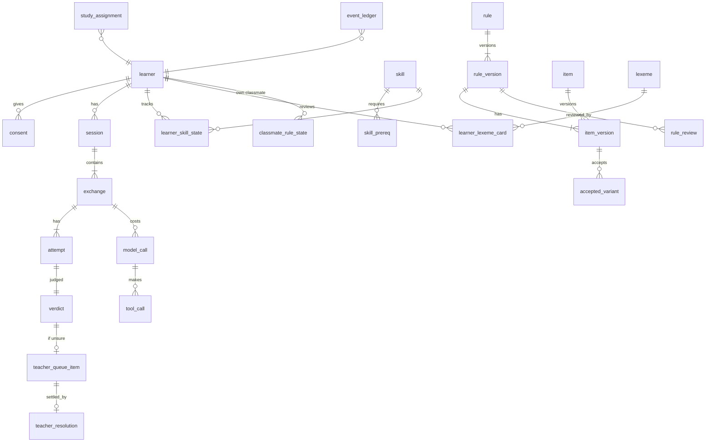

# Data model

Postgres is the source of truth [P-ARCH-11]. Content versions are immutable. Learning state is written only by OutcomeWriter [E-01]. Every event goes to an append-only ledger [E-02]. Tags: [P] paper · [X] prompt extension · [E] engineering recommendation.

## 1. Entity overview



## 2. Tables (key columns)

### Identity and consent

| Table | Columns |
|---|---|
| `learner` | `id uuid` (pseudonymous), `handle` (random), `passphrase_hash`, `l1` ('hi'\|'te'), `l2`, `direction` ('HI->TE'\|'TE->HI'), `role` (learner\|teacher\|researcher\|admin), `created_at`, `cohort`, `romanisation_enabled bool=false` |
| `consent` | `learner_id`, `form_version`, `signed_at`, `scope[]` (pilot, audio, writing_upload), `withdrawn_at` |
| `background` | `learner_id`, questionnaire answers (script familiarity, schooling, exposure, region) for fairness analysis [FW-R16]. No names, phone numbers or emails |

### Skills and words

| Table | Columns |
|---|---|
| `skill` | `id`, `band` L0–L5, `family`, `target`, `modality` (REC/RCL/RD/LS/SP/EX/PR), `direction`, `content_ref`, `active` |
| `skill_prereq` | `skill_id`, `requires_id` |
| `learner_skill_state` | see learning-ladder.md §2 |
| `lexeme` | `id`, `telugu`, `hindi_gloss` (Devanagari), `pos`, `freq_rank`, `freq_source`, `cognate_of`, `false_friend bool`, `false_friend_note_hi`, `audio_asset_id`, `source_id`, `review_status` |
| `learner_lexeme_card` | FSRS state per (learner, lexeme or chunk, modality): `stability`, `difficulty`, `due`, `last_review`, `reps`, `lapses`, `fsrs_version` |

### Rules and items

| Table | Columns |
|---|---|
| `rule` | `id` (e.g. HI-TE-001), `direction`, `contrast_area`, `created_at` |
| `rule_version` (immutable) | `rule_id`, `version`, `title_hi`, `l1_explanation_hi`, `concept_key` (json: required ideas and relations, no Latin), `band`, `target_skill_id`, `validity` (verified\|uncertain\|rejected), `learner_evidence` (model_predicted\|predicted\|proxy\|observed\|replicated), `lifecycle` (draft\|review\|verified\|active\|deprecated\|rejected), `teacher_approved bool`, `sources` (json citations), `licence`, `reviewers` (json), `reviewed_at`, `speaker_approvals` (json: lang, reviewer, date), `region_register_notes`, `opportunities int`, `observed_errors int`, `supersedes_version`, `change_note` |
| `item` / `item_version` (immutable) | `item_id` (pattern `(HI-TE\|TE-HI)-NNN-x`), `version`, `rule_version_ref`, `template`, `hindi_meaning`, `wrong_form`, `one_error_span` [start, end], `correct_form`, `no_error_equivalent`, `wrong_patterns[]` (anchored), `accept_patterns[]` (anchored), `vocab_prereqs[]`, `allowed_target_forms[]`, `analyser_requirements`, `band`, `band_reason`, `leveler_version`, `pool` (practice\|test_heldout\|diagnostic), `review_status` |
| `accepted_variant` | `item_version_ref`, `form`, `register` (written\|spoken), `region`, `status` (proposed\|approved\|rejected), `approvals` (json, ≥ 2 for approved) |
| `rule_review` | `rule_version_ref`, `reviewer_id`, `language`, `acceptable_natural` (1–5), `category_ok`, `explanation_ok` (1–5), `band_fit`, `confidence` (1–5), `comments_hi`, `round` (1\|2\|3) |
| `kappa_report` | `batch`, `metric`, `kappa`, `n`, `computed_at` |
| `hint` | `rule_version_ref`, `type` (recast\|l1_rule\|contrast), `text_hi`, `status`, `validated_no_answer bool` |
| `scene` / `scene_line` | approved scripts, lines, expected reply frames, review status |
| `own_task` | `target_skill`, `goal_hi`, `frames[]`, `slot_lexicon[]` |
| `data_source` | the register (see data-source-register.md) |
| `content_proposal` | `kind` (rule\|variant\|span), `payload`, `origin` (llm\|upload\|teacher), `evidence` (= model_predicted for LLM), `status` |

### Sessions and outcomes

| Table | Columns |
|---|---|
| `session` | `id`, `learner_id`, `mode` (learn\|study_A\|study_B\|study_C\|diagnostic\|test_pre\|test_post\|test_delayed\|test_transfer), `config_snapshot` json, `seed`, `started_at`, `ended_at`, `time_on_task_s` |
| `exchange` | `id`, `session_id`, `kind` (correction\|no_error\|own\|review\|learn\|scene\|mirror), `rule_version_ref`, `item_version_ref`, `planted bool`, `shown_text`, `source` (model\|bank\|template), `model_versions` json, `prompt_version`, `leveler_version`, `tokenizer_version`, `tmr`, `created_at` |
| `attempt` | `id`, `exchange_id`, `n`, `raw_text`, `normalised_text`, `input_script`, `forgiveness_applied`, `aid_visible`, `hint_type`, `hint_id`, `after_reveal bool`, `confidence` (nullable, flag), `latency_ms`, `idempotency_key unique` |
| `verdict` | `attempt_id`, `outcome` (correct\|partial\|wrong\|unsure), `kind` (fix\|no_error\|explanation\|own\|recall), `reason_code`, `checker_version`, `false_alarm bool` |
| `copy_event` | `learner_id`, `rule_id`, `attempt_id` |
| `model_call` | `id`, `exchange_id`, `agent` (classmate\|coach\|friend), `model`, `prompt_version`, `request_hash` (the prompt is stored only in dev, and never contains learner text for the classmate), `response_text`, `latency_ms`, `error` |
| `tool_call` | `model_call_id`, `tool`, `args` json, `result` json, `valid bool` |
| `teacher_queue_item` | `verdict_id`, `status`, `created_at` |
| `teacher_resolution` | `queue_item_id`, `teacher_id`, `outcome`, `note_hi`, `variant_proposal`, `resolved_at` |
| `teacher_override` | `attempt_id`, `teacher_id`, `old_outcome`, `new_outcome`, `reason_hi` (audited; applied through OutcomeWriter) |

### Learning state (written only by OutcomeWriter)

| Table | Columns |
|---|---|
| `learner_skill_state` | see learning-ladder.md §2 |
| `classmate_rule_state` | `learner_id`, `rule_id`, `state` (unknown\|taught\|forgotten), `state_version`, `last_event_id` |
| `classmate_vl` (view) | words and forms of mastered or seen lexemes and items for the learner, plus the allowed target forms per planted item |

### Study

| Table | Columns |
|---|---|
| `study` | `id`, `prereg_ref`, `threshold_file_hash`, `square` |
| `study_assignment` | `learner_id`, `rule_id`, `condition` (A\|B\|C), `order` |
| `test_administration` | `learner_id`, `phase`, `item_version_ref`, `scheduled_for` |
| `blind_mark` | `export_id`, `rater_id`, `response_id` (random), `score`, `rubric_version` |

### Memory Assistant (amendment A1)

| Table | Columns |
|---|---|
| `concept` | `id`, `kind` (letter\|sound\|akshara\|lexeme\|false_friend\|rule\|chunk\|scene), `content_ref`, `fact_sheet` json (verified fact ids only) |
| `technique_policy` | `version`, `unit_kind`, `technique`, `default_rank`, `active` |
| `memory_aid` (immutable versions) | `id`, `concept_id`, `technique`, `version`, `text_hi`, `telugu_spans`, `uses_facts[]`, `lures[]` (declared misassociation forms), `visual_asset_id`, `audio_asset_id`, `audio_alt_hi_id`, `alt_text_hi`, `generation` json (tool, model, prompt, seed or `manual`), `validator_results` json, `review_status` (draft\|in_review\|approved\|rejected\|retired), `reviewers` json, `licence`, `provenance`, `retired_reason`, `supersedes` |
| `visual_asset` | `id`, `uri`, `sha256`, `phash`, `prompt`, `negative_prompt`, `model`, `provider` (self_hosted\|external_offline), `seed`, `ocr_result`, `safety_result`, `contrast_ok`, `review_status`, `licence`, `alt_text_hi` |
| `audio_asset` | `id`, `uri`, `kind` (native_recording\|tts_reviewed), `speaker_consent_id`, `rights`, `review_status` |
| `aid_event` | `id`, `learner_id`, `concept_id`, `memory_aid_id` (or `fallback:<kind>`), `event` (presented\|selected\|used\|dismissed), `recommended_by` (policy\|teacher_model\|study_fixed), `rank`, `exploration bool`, `dwell_ms`, `session_id`, `ts` |
| `concept_cue_state` | `learner_id`, `concept_id`, `cue_level` 0–3, `updated_by_event` (written by OutcomeWriter) |
| `technique_effect` | `scope` (learner\|population), `learner_id` (nullable), `technique`, `alpha`, `beta`, `n`, `updated_at` |
| `aid_misassociation` | `attempt_id`, `memory_aid_id`, `lure` |
| `generation_cost` | `id`, `batch_id`, `provider`, `model`, `units` (GPU-s or images), `cost`, `ts` |

`attempt` gains `cue_level` (0–3) and `aid_visible_before_answer bool`. The FSRS review log gains `cue_level`.

Mastery rule: OutcomeWriter ignores `aid_event` for mastery. Attempts with `cue_level > 0` cap the FSRS rating at Hard and never count toward unlock.

### Audit

| Table | Columns |
|---|---|
| `event_ledger` | `id bigserial`, `ts`, `actor` (checker\|teacher:<id>\|scheduler), `event_type`, `payload` json, `prev_hash`, `hash`. A trigger rejects UPDATE and DELETE |

## 3. State machines

**Classmate rule [P8b-01]:**

| From | Event | To |
|---|---|---|
| unknown | learner taught + checked correct once (or pre-test correct) → `Teach` | taught |
| taught | learner predicted recall < 0.5 → `Forget` | forgotten |
| forgotten | checked correct fix → `Teach` | taught |
| any | unsure, wrong, partial, bare "wrong", why-answer, model statement | **no change** |

**Rule lifecycle [X-BANK-06]:**

```
draft → review → verified → active → deprecated
                          ↘ rejected
```

- `verified` requires `validity = verified`, reviews from 2 speakers per language, and a third reviewer if they disagreed.
- `active` additionally requires `teacher_approved = true` and every item validated (one error span, anchored patterns, no answer in its hints).
- Every transition creates a new `rule_version`.

**Skill:**

```
locked → available → learning → mastered ⇄ due → relearning → mastered
```

`placed` is a pending variant of `mastered` until its confirmation review.

**Teacher queue item:** `open → resolved | escalated (third reviewer) → resolved`.

## 4. Versioning

- `rule_version`, `item_version` and `hint` are immutable. A correction inserts a new version with `supersedes_version`.
- Sessions pin the versions they used.
- Recorded on every exchange: `checker_version`, `tokenizer_version`, `leveler_version`, `prompt_version`, `fsrs_version`, `model`.

## 5. Retention and privacy [P-ETH-05, X-PRIV-01]

- Pseudonymous ids only. No names, emails or phone numbers in the database. The facilitator keeps any link key offline.
- Raw learner text is kept for the study period plus 12 months [E default; set by the ethics approval]. Exports use random response ids.
- The classmate prompt never contains learner text, so `model_call` rows hold none. The coach and friend `<learner_text>` field is stored only as `request_hash` in production.
- Withdrawing consent deletes raw learner text and anonymises the ledger payloads (hashes are kept).
- No runtime egress except the self-hosted model and speech hosts.

## 6. Migration from the current files (Phase 1)

| From | To | Rule |
|---|---|---|
| setu `data/hi-te/L0-*.json`, `L1-*.json` | `content/hi-te/letters`, `lexicon` YAML → `skill`, `lexeme`, `item_version` | `review_status = draft`; mnemonics kept as draft hints; emoji and `picture` fields dropped |
| setu `data/hi-te/rules.json` + LMA `data/l1-hi_l2-te/rules.json` | `content/hi-te/rules` → `rule_version` v1 | `validity = uncertain`; `learner_evidence = model_predicted` (or `predicted` where the source cites Krishnamurti & Gwynn); `lifecycle = draft`; Hindi explanations kept; English `name` / `l1_habit` moved to developer notes (never learner-facing); known defects listed in content-and-error-bank.md §6 |
| LMA `data/l1-te_l2-hi/rules.json` | `content/te-hi/rules` | Same as above, `direction = TE->HI` |
| LMA `tests_v0.jsonl`, `teacher_labels_v0.csv` | `tests/stage_a/dev` and a labelling batch | The held-out manifest is regenerated once and then frozen |
| setu `runs/*.json` (dev learner) | Not migrated | Developer test data only |
| setu `runs/ai/aids.json`, images | Not migrated as approved content | Unreviewed. Tricks may be re-imported as `memory_aid` **drafts** through the grounding validator and teacher review (ADR-0005); the SVG pictures are discarded |

## 7. Indexes and integrity

- Unique `(learner_id, rule_id)` on `classmate_rule_state`.
- Unique `attempt.idempotency_key`.
- `CHECK (validity <> 'verified' OR jsonb_array_length(speaker_approvals) >= 2)`.
- `CHECK (lifecycle <> 'active' OR (validity = 'verified' AND teacher_approved))`.

## 8. OKF export [X-MEM-03]

- `export/okf/<learner_handle>/` contains `profile.md`, `skills/<skill_id>.md`, `rules/<rule_id>.md`, `classmate.md` and `sessions/<date>.md`.
- Each file is Markdown with a YAML header carrying `okf_version`, `source: postgres`, `generated_at` and `ledger_head_hash`.
- The export is read-only, regenerated on demand, and never imported back.
- Acceptance: for any learner, the export is regenerated after an event, and the YAML values equal the database values. TS-OKF-01..03.
