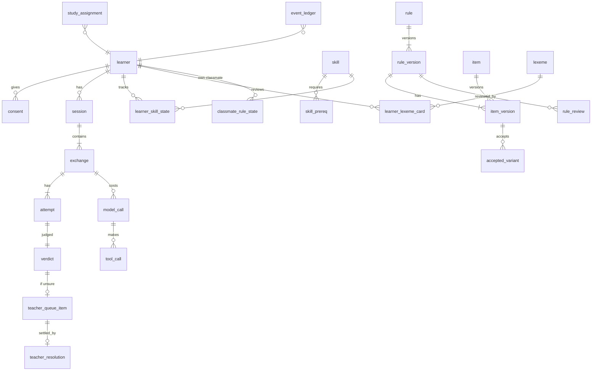

# Data model

Postgres is the source of truth [P-ARCH-11]. Content versions are immutable. Learning state is written only by OutcomeWriter [E-01]. Every event goes to an append-only ledger [E-02]. Tags: [P] paper · [X] prompt extension · [E] engineering recommendation.

## 1. Entity overview



## 2. Tables (key columns)

### Identity and consent

| Table | Columns |
|---|---|
| `learner` | `id uuid` (pseudonymous), `handle` (random), `passphrase_hash`, `l1` ('hi'\|'te'), `l2`, `direction` ('HI->TE'\|'TE->HI'), `role` (learner\|teacher\|researcher\|admin), `created_at`, `cohort`, `romanisation_enabled bool=false` |
| `consent` | `learner_id`, `form_version`, `signed_at`, `scope[]` (pilot, audio, writing_upload), `withdrawn_at` |
| `background` | `learner_id`, questionnaire answers (script familiarity, schooling, exposure, region) for fairness analysis [FW-R16]. No names, phone numbers or emails |

### Skills and words

| Table | Columns |
|---|---|
| `skill` | `id`, `band` L0–L5, `family`, `target`, `modality` (REC/RCL/RD/LS/SP/EX/PR), `direction`, `content_ref`, `active` |
| `skill_prereq` | `skill_id`, `requires_id` |
| `learner_skill_state` | see learning-ladder.md §2 |
| `lexeme` | `id`, `telugu`, `hindi_gloss` (Devanagari), `pos`, `freq_rank`, `freq_source`, `cognate_of`, `false_friend bool`, `false_friend_note_hi`, `audio_asset_id`, `source_id`, `review_status` |
| `learner_lexeme_card` | FSRS state per (learner, lexeme or chunk, modality): `stability`, `difficulty`, `due`, `last_review`, `reps`, `lapses`, `fsrs_version` |

### Rules and items

| Table | Columns |
|---|---|
| `rule` | `id` (e.g. HI-TE-001), `direction`, `contrast_area`, `created_at` |
| `rule_version` (immutable) | `rule_id`, `version`, `title_hi`, `l1_explanation_hi`, `concept_key` (json: required ideas and relations, no Latin), `band`, `target_skill_id`, `validity` (verified\|uncertain\|rejected), `learner_evidence` (model_predicted\|predicted\|proxy\|observed\|replicated), `lifecycle` (draft\|review\|verified\|active\|deprecated\|rejected), `teacher_approved bool`, `sources` (json citations), `licence`, `reviewers` (json), `reviewed_at`, `speaker_approvals` (json: lang, reviewer, date), `region_register_notes`, `opportunities int`, `observed_errors int`, `supersedes_version`, `change_note` |
| `item` / `item_version` (immutable) | `item_id` (pattern `(HI-TE\|TE-HI)-NNN-x`), `version`, `rule_version_ref`, `template`, `hindi_meaning`, `wrong_form`, `one_error_span` [start, end], `correct_form`, `no_error_equivalent`, `wrong_patterns[]` (anchored), `accept_patterns[]` (anchored), `vocab_prereqs[]`, `allowed_target_forms[]`, `analyser_requirements`, `band`, `band_reason`, `leveler_version`, `pool` (practice\|test_heldout\|diagnostic), `review_status` |
| `accepted_variant` | `item_version_ref`, `form`, `register` (written\|spoken), `region`, `status` (proposed\|approved\|rejected), `approvals` (json, ≥ 2 for approved) |
| `rule_review` | `rule_version_ref`, `reviewer_id`, `language`, `acceptable_natural` (1–5), `category_ok`, `explanation_ok` (1–5), `band_fit`, `confidence` (1–5), `comments_hi`, `round` (1\|2\|3) |
| `kappa_report` | `batch`, `metric`, `kappa`, `n`, `computed_at` |
| `hint` | `rule_version_ref`, `type` (recast\|l1_rule\|contrast), `text_hi`, `status`, `validated_no_answer bool` |
| `scene` / `scene_line` | approved scripts, lines, expected reply frames, review status |
| `own_task` | `target_skill`, `goal_hi`, `frames[]`, `slot_lexicon[]` |
| `data_source` | the register (see data-source-register.md) |
| `content_proposal` | `kind` (rule\|variant\|span), `payload`, `origin` (llm\|upload\|teacher), `evidence` (= model_predicted for LLM), `status` |

### Sessions and outcomes

| Table | Columns |
|---|---|
| `session` | `id`, `learner_id`, `mode` (learn\|study_A\|study_B\|study_C\|diagnostic\|test_pre\|test_post\|test_delayed\|test_transfer), `config_snapshot` json, `seed`, `started_at`, `ended_at`, `time_on_task_s` |
| `exchange` | `id`, `session_id`, `kind` (correction\|no_error\|own\|review\|learn\|scene\|mirror), `rule_version_ref`, `item_version_ref`, `planted bool`, `shown_text`, `source` (model\|bank\|template), `model_versions` json, `prompt_version`, `leveler_version`, `tokenizer_version`, `tmr`, `created_at` |
| `attempt` | `id`, `exchange_id`, `n`, `raw_text`, `normalised_text`, `input_script`, `forgiveness_applied`, `aid_visible`, `hint_type`, `hint_id`, `after_reveal bool`, `confidence` (nullable, flag), `latency_ms`, `idempotency_key unique` |
| `verdict` | `attempt_id`, `outcome` (correct\|partial\|wrong\|unsure), `kind` (fix\|no_error\|explanation\|own\|recall), `reason_code`, `checker_version`, `false_alarm bool` |
| `copy_event` | `learner_id`, `rule_id`, `attempt_id` |
| `model_call` | `id`, `exchange_id`, `agent` (classmate\|coach\|friend), `model`, `prompt_version`, `request_hash` (the prompt is stored only in dev, and never contains learner text for the classmate), `response_text`, `latency_ms`, `error` |
| `tool_call` | `model_call_id`, `tool`, `args` json, `result` json, `valid bool` |
| `teacher_queue_item` | `verdict_id`, `status`, `created_at` |
| `teacher_resolution` | `queue_item_id`, `teacher_id`, `outcome`, `note_hi`, `variant_proposal`, `resolved_at` |
| `teacher_override` | `attempt_id`, `teacher_id`, `old_outcome`, `new_outcome`, `reason_hi` (audited; applied through OutcomeWriter) |

### Learning state (written only by OutcomeWriter)

| Table | Columns |
|---|---|
| `learner_skill_state` | see learning-ladder.md §2 |
| `classmate_rule_state` | `learner_id`, `rule_id`, `state` (unknown\|taught\|forgotten), `state_version`, `last_event_id` |
| `classmate_vl` (view) | words and forms of mastered or seen lexemes and items for the learner, plus the allowed target forms per planted item |

### Study

| Table | Columns |
|---|---|
| `study` | `id`, `prereg_ref`, `threshold_file_hash`, `square` |
| `study_assignment` | `learner_id`, `rule_id`, `condition` (A\|B\|C), `order` |
| `test_administration` | `learner_id`, `phase`, `item_version_ref`, `scheduled_for` |
| `blind_mark` | `export_id`, `rater_id`, `response_id` (random), `score`, `rubric_version` |

### Memory Assistant (amendment A1)

| Table | Columns |
|---|---|
| `concept` | `id`, `kind` (letter\|sound\|akshara\|lexeme\|false_friend\|rule\|chunk\|scene), `content_ref`, `fact_sheet` json (verified fact ids only) |
| `technique_policy` | `version`, `unit_kind`, `technique`, `default_rank`, `active` |
| `memory_aid` (immutable versions) | `id`, `concept_id`, `technique`, `version`, `text_hi`, `telugu_spans`, `uses_facts[]`, `lures[]` (declared misassociation forms), `visual_asset_id`, `audio_asset_id`, `audio_alt_hi_id`, `alt_text_hi`, `generation` json (tool, model, prompt, seed or `manual`), `validator_results` json, `review_status` (draft\|in_review\|approved\|rejected\|retired), `reviewers` json, `licence`, `provenance`, `retired_reason`, `supersedes` |
| `visual_asset` | `id`, `uri`, `sha256`, `phash`, `prompt`, `negative_prompt`, `model`, `provider` (self_hosted\|external_offline), `seed`, `ocr_result`, `safety_result`, `contrast_ok`, `review_status`, `licence`, `alt_text_hi` |
| `audio_asset` | `id`, `uri`, `kind` (native_recording\|tts_reviewed), `speaker_consent_id`, `rights`, `review_status` |
| `aid_event` | `id`, `learner_id`, `concept_id`, `memory_aid_id` (or `fallback:<kind>`), `event` (presented\|selected\|used\|dismissed), `recommended_by` (policy\|teacher_model\|study_fixed), `rank`, `exploration bool`, `dwell_ms`, `session_id`, `ts` |
| `concept_cue_state` | `learner_id`, `concept_id`, `cue_level` 0–3, `updated_by_event` (written by OutcomeWriter) |
| `technique_effect` | `scope` (learner\|population), `learner_id` (nullable), `technique`, `alpha`, `beta`, `n`, `updated_at` |
| `aid_misassociation` | `attempt_id`, `memory_aid_id`, `lure` |
| `generation_cost` | `id`, `batch_id`, `provider`, `model`, `units` (GPU-s or images), `cost`, `ts` |

`attempt` gains `cue_level` (0–3) and `aid_visible_before_answer bool`. The FSRS review log gains `cue_level`.

Mastery rule: OutcomeWriter ignores `aid_event` for mastery. Attempts with `cue_level > 0` cap the FSRS rating at Hard and never count toward unlock.

### Audit

| Table | Columns |
|---|---|
| `event_ledger` | `id bigserial`, `ts`, `actor` (checker\|teacher:<id>\|scheduler), `event_type`, `payload` json, `prev_hash`, `hash`. A trigger rejects UPDATE and DELETE |

## 3. State machines

**Classmate rule [P8b-01]:**

| From | Event | To |
|---|---|---|
| unknown | learner taught + checked correct once (or pre-test correct) → `Teach` | taught |
| taught | learner predicted recall < 0.5 → `Forget` | forgotten |
| forgotten | checked correct fix → `Teach` | taught |
| any | unsure, wrong, partial, bare "wrong", why-answer, model statement | **no change** |

**Rule lifecycle [X-BANK-06]:**

```
draft → review → verified → active → deprecated
                          ↘ rejected
```

- `verified` requires `validity = verified`, reviews from 2 speakers per language, and a third reviewer if they disagreed.
- `active` additionally requires `teacher_approved = true` and every item validated (one error span, anchored patterns, no answer in its hints).
- Every transition creates a new `rule_version`.

**Skill:**

```
locked → available → learning → mastered ⇄ due → relearning → mastered
```

`placed` is a pending variant of `mastered` until its confirmation review.

**Teacher queue item:** `open → resolved | escalated (third reviewer) → resolved`.

## 4. Versioning

- `rule_version`, `item_version` and `hint` are immutable. A correction inserts a new version with `supersedes_version`.
- Sessions pin the versions they used.
- Recorded on every exchange: `checker_version`, `tokenizer_version`, `leveler_version`, `prompt_version`, `fsrs_version`, `model`.

## 5. Retention and privacy [P-ETH-05, X-PRIV-01]

- Pseudonymous ids only. No names, emails or phone numbers in the database. The facilitator keeps any link key offline.
- Raw learner text is kept for the study period plus 12 months [E default; set by the ethics approval]. Exports use random response ids.
- The classmate prompt never contains learner text, so `model_call` rows hold none. The coach and friend `<learner_text>` field is stored only as `request_hash` in production.
- Withdrawing consent deletes raw learner text and anonymises the ledger payloads (hashes are kept).
- No runtime egress except the self-hosted model and speech hosts.

## 6. Migration from the current files (Phase 1)

| From | To | Rule |
|---|---|---|
| setu `data/hi-te/L0-*.json`, `L1-*.json` | `content/hi-te/letters`, `lexicon` YAML → `skill`, `lexeme`, `item_version` | `review_status = draft`; mnemonics kept as draft hints; emoji and `picture` fields dropped |
| setu `data/hi-te/rules.json` + LMA `data/l1-hi_l2-te/rules.json` | `content/hi-te/rules` → `rule_version` v1 | `validity = uncertain`; `learner_evidence = model_predicted` (or `predicted` where the source cites Krishnamurti & Gwynn); `lifecycle = draft`; Hindi explanations kept; English `name` / `l1_habit` moved to developer notes (never learner-facing); known defects listed in content-and-error-bank.md §6 |
| LMA `data/l1-te_l2-hi/rules.json` | `content/te-hi/rules` | Same as above, `direction = TE->HI` |
| LMA `tests_v0.jsonl`, `teacher_labels_v0.csv` | `tests/stage_a/dev` and a labelling batch | The held-out manifest is regenerated once and then frozen |
| setu `runs/*.json` (dev learner) | Not migrated | Developer test data only |
| setu `runs/ai/aids.json`, images | Not migrated as approved content | Unreviewed. Tricks may be re-imported as `memory_aid` **drafts** through the grounding validator and teacher review (ADR-0005); the SVG pictures are discarded |

## 7. Indexes and integrity

- Unique `(learner_id, rule_id)` on `classmate_rule_state`.
- Unique `attempt.idempotency_key`.
- `CHECK (validity <> 'verified' OR jsonb_array_length(speaker_approvals) >= 2)`.
- `CHECK (lifecycle <> 'active' OR (validity = 'verified' AND teacher_approved))`.

## 8. OKF export [X-MEM-03]

- `export/okf/<learner_handle>/` contains `profile.md`, `skills/<skill_id>.md`, `rules/<rule_id>.md`, `classmate.md` and `sessions/<date>.md`.
- Each file is Markdown with a YAML header carrying `okf_version`, `source: postgres`, `generated_at` and `ledger_head_hash`.
- The export is read-only, regenerated on demand, and never imported back.
- Acceptance: for any learner, the export is regenerated after an event, and the YAML values equal the database values. TS-OKF-01..03.

## 9. Implementation notes (slice 1.2, 31 Oct 2026)

These refine the tables above to match the code in `setu/store/` and migration `0001`.

| Topic | As built | Why |
|---|---|---|
| Roles | Five roles instead of the three named in architecture §8: `setu_app` and `setu_content` were added | The spec gave the web layer only `setu_read`, but the web layer must record sessions and attempts. Content import and review also had no role. Both new roles are narrower than giving `setu_writer` those jobs. `setu_writer` stays the only role that can write learning state |
| `setu_read` scope | Content and learning-state tables, plus learner columns without `passphrase_hash`. No attempts, consent, background, model calls, ledger or teacher notes | Least privilege for agent tools (prompt-injection blast radius) |
| `learner_lexeme_card` | Generalised to `card_kind` (letter, akshara, lexeme, chunk) + `card_ref` | Amendment A1 makes letters and akshara FSRS cards too |
| `fsrs_review_log` | New table; `CHECK (cue_level = 0 OR rating <= 2)` | Enforces the A1 rule that a visible cue caps the rating at Hard |
| `event_ledger` | `id`, `ts`, `prev_hash` and `hash` are set by a trigger (client values ignored); appends are serialised with an advisory lock and must run at READ COMMITTED; `setu_verify_ledger()` returns the first broken id. UPDATE, DELETE and TRUNCATE raise | E-02 |
| Verified rules | Besides the §7 CHECK (≥ 2 approvals), a trigger requires **two distinct reviewers of the rule's target language** (Telugu for HI→TE, Hindi for TE→HI) | Paper: two native speakers per language; a count alone accepts the same reviewer twice |
| Immutability | `rule_version`, `item_version`, `hint`, `verdict` reject UPDATE, DELETE and TRUNCATE. `memory_aid` content columns are immutable, its status follows draft → in_review → approved → retired (or rejected), and retirement needs a reason | data-model §4, A1 |
| `study_assignment`, `session.mode`, `test_administration.phase` | Also accept Study M conditions (M-A..M-D, day1/day7/day30) | Amendment A1 |
| `model_call.agent` | Includes `teacher` | A1: the AI teacher may choose among aid candidates |
| `visual_asset.ocr_text_found` | New boolean next to `ocr_result`; approval requires `false`, contrast ok, alt text and licence | Makes "no embedded text" enforceable in the database |
| **Deferred** | `classmate_vl` view → slice 2.5 (it depends on the seen-forms rules); anchored-pattern validation for `item_version` patterns → content validator, slice 1.4; consent-withdrawal deletion procedure → slice 1.5 | Not schema-only concerns |
| Classmate-state guard (slice 1.3, migration 0002) | A trigger on `classmate_rule_state` refuses any insert or update not backed by its evidence: **taught** needs a `classmate_taught` ledger event that points to a correct `fix` verdict on a planted `correction` exchange of that rule by that learner (actor `checker`), or to a teacher resolution settling such an answer as correct (actor `teacher:<id>`); **forgotten** needs a `classmate_forgot` event from `scheduler` with predicted recall < 0.5, and only from taught; **unknown** only as an initial row with a `classmate_initialised` event. Versions move by exactly one; evidence older than the last change is refused (no replay); each ledger event backs at most one change (`UNIQUE (last_event_id)`); rows cannot be deleted | Defence in depth for P8b-01 and X-CLS-NOTRUST that does not depend on Python code |
| Ledger event types in use | `verdict_recorded`, `classmate_taught`, `classmate_forgot`, `classmate_initialised`, `teacher_resolution` | Slice 1.3 |
| Content provenance and validation (slice 1.4, migration 0003) | `rule_version`, `item_version`, `accepted_variant`, `lexeme`, `scene` gain `provenance` (repo, commit, path, JSON pointer, record sha256, raw record for top-level records); versioned records gain `validation_issues` and `content_hash` (idempotent import). A rule cannot be verified with open issues or without learner-language text; an item cannot be approved with open issues | Lossless import; issues block approval |
| Learner-language columns | `rule_version.title_hi`, `l1_explanation_hi` and `item_version.hindi_meaning` hold the **learner's L1**: Hindi for HI→TE, Telugu for TE→HI. The names predate TE→HI content; YAML calls them `title_l1`, `explanation_l1`, `l1_meaning`. `title_hi`/`l1_explanation_hi` became nullable for drafts | TE→HI drafts have no Telugu text yet |
| No Latin in learner-facing columns | `setu_no_latin()` CHECKs on every learner-facing text column (rule titles and explanations, item meanings and forms, variants, hints, lexemes, scenes, scene lines, own tasks, memory aids, alt texts) | Database backstop for X-NOENG |
| Anchored patterns | `setu_patterns_anchored()` CHECK on `accept_patterns` and `wrong_patterns`: each must start with `^` and end with an unescaped `$`. Full validation (top-level alternation, wildcards, lookarounds, backreferences, nested or large repeats, empty match, script, semantic checks) is in `setu/content/patterns.py` | Backstop for DQ-06/07 |
| Learner-visible views | `learner_rule_version` (newest version only, active + verified + teacher-approved), `learner_item_version` (newest, approved, no issues, rule visible), `learner_accepted_variant`, `learner_hint`, `learner_lexeme`, `learner_scene`, `learner_scene_line`, `learner_own_task`, `learner_memory_aid`. Since grant plan V2, **`setu_read` has no access to the draft-bearing base tables** and reads content only through these views. A newer deprecated version hides a rule | No unreviewed Telugu reaches learners or model-facing tools |
| Grant plans | `grants.PLAN_V1` (as applied by 0001) is frozen; `PLAN_V2` (0003) is current. Migrations apply a plan from a clean slate (revoke all, then grant) | Migrations stay reproducible as the plan evolves |
| Not yet in the database | Letter units (L0) and the drill items of word units (L1) are kept verbatim in `content/hi-te/letters/` and `word_units/` and import in slice 3 (S1/S3); `item_version.pool` is `practice` for everything until held-out pools are drawn for the study | Letter skills and test pools are later decisions |
| Accounts (slice 1.5, migration 0004) | New tables `invite` (sha256 of the code, role, cohort, expiry, single use), `auth_session` (sha256 of the token, 14-day expiry, revocation) and `login_attempt` (handle, ok, time: no IP or user agent). Handles are random digits (`1234-5678`) so no Latin appears to learners; passphrases are argon2id. Only `setu_app` can touch these tables (grant plan V3) | E-08, X-PRIV-01 |
| Consent guard | A trigger refuses a `session` without active consent; study and test sessions need the `pilot` scope. `consent.scope` may not be empty | P-ETH-04, TS-PRIV-01 |
| Withdrawal | `setu_withdraw_consent(learner)` (SECURITY DEFINER, EXECUTE for `setu_app` only) ends consent, empties `attempt.raw_text` / `normalised_text` and sets `redacted_at` (a CHECK keeps redacted rows empty), deletes `background`, revokes sessions. **Deviation from §5:** the ledger is not "anonymised", because it is append-only and hash-chained and, by construction, holds only pseudonymous ids and outcomes, never learner text (a test checks this). Learning state stays for the analysis the learner agreed to; whether withdrawal should also remove it is a decision for the ethics protocol | data-model §5 |
| Known limits | The web layer, not the database, decides who may withdraw whom (researcher route, learner self-route); the withdrawal function runs with its owner's rights, so in production its owner must be the non-superuser migration role. Cookies are HttpOnly, Secure, SameSite=Lax (no separate CSRF token yet; JSON endpoints only). Consent form text is a catalog key: the Hindi text must be the ethics-approved version (gate G4) | Slice 1.5 |

